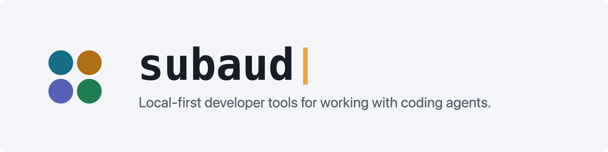

<picture>
  <source media="(prefers-color-scheme: dark)" srcset="assets/banner-dark.png">
  
</picture>

subaud tools are small developer tools for working with coding agents on your own machine. Each one keeps its state on your disk. The command-line tools install as a single binary for macOS and Linux, on arm64 and amd64, and the pi extensions install from npm.

<table>
<tr>
<td width="50%" valign="top">&nbsp;<a href="https://galley.tools"><b>galley</b></a> &nbsp;Reviews documents with you in the browser and sends your notes to the agent that wrote them.</td>
<td width="50%" valign="top">&nbsp;<a href="https://muster.tools"><b>muster</b></a> &nbsp;Lets agent sessions on one machine message each other and share tasks.</td>
</tr>
<tr>
<td width="50%" valign="top">&nbsp;<a href="https://kempt.tools"><b>kempt</b></a> &nbsp;Sets up a machine from a manifest you can read before anything runs.</td>
<td width="50%" valign="top">&nbsp;<a href="https://casebook.tools"><b>casebook</b></a> &nbsp;Keeps a decision for every repo, pull request, issue, branch and worktree, in a private git repository you own.</td>
</tr>
<tr>
<td width="50%" valign="top">&nbsp;<a href="https://muda.tools"><b>muda</b></a> &nbsp;Finds the slow and wasted steps in a GitHub Actions pipeline, with the run evidence for each one.</td>
<td width="50%" valign="top">&nbsp;<a href="https://hail.tools"><b>hail</b></a> &nbsp;Reaches a running pi session from your phone.</td>
</tr>
<tr>
<td width="50%" valign="top">&nbsp;<a href="https://channels.tools"><b>channels</b></a> &nbsp;Connects local channel servers to a running pi session.</td>
<td width="50%" valign="top">&nbsp;<a href="https://tackle.tools"><b>tackle</b></a> &nbsp;Smaller terminal tools: scratch, proj, creel, sift and imprint.</td>
</tr>
</table>

Each site has the install line and the docs for its tool. [subaud.tools](https://subaud.tools) lists the whole family.
